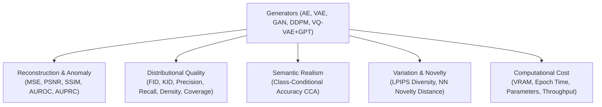

# Construction Site AI: Evaluation Metrics & Mathematical Formulations

**Project:** Construction Site AI — Generative Safety Monitoring  
**Target Architecture:** Tier B (NVIDIA RTX 3050 6GB Laptop GPU)  
**Standardized Benchmark Protocol:** Resolution $64 \times 64$, Sample Size $N = 2,048$, Mixed Precision FP16  

---

## 1. Overview & Evaluation Philosophy

To impartially benchmark five disparate generative architectures (**Autoencoder**, **VAE**, **Conditional GAN**, **Conditional Diffusion**, **VQ-VAE + Transformer**), we implement a unified, multi-dimensional evaluation suite. Generative models cannot be assessed on loss alone; they must be examined across fidelity, distribution coverage, diversity, anti-memorization (novelty), class alignment, anomaly discriminability, and computational efficiency.

---

## 2. Reconstruction & Anomaly Detection Metrics

### 2.1 Mean Squared Error (MSE) & Peak Signal-to-Noise Ratio (PSNR)
For an input crop $x \in \mathbb{R}^{C \times H \times W}$ and its reconstruction $\hat{x}$:
$$\text{MSE}(x, \hat{x}) = \frac{1}{C \cdot H \cdot W} \sum_{c=1}^C \sum_{i=1}^H \sum_{j=1}^W (x_{c,i,j} - \hat{x}_{c,i,j})^2$$
$$\text{PSNR}(x, \hat{x}) = 10 \cdot \log_{10} \left( \frac{\text{MAX}_I^2}{\text{MSE}(x, \hat{x})} \right)$$
where $\text{MAX}_I = 1.0$ for images normalized to $[0, 1]$.

### 2.2 Structural Similarity Index Measure (SSIM)
Measures structural, luminance, and contrast degradation rather than raw pixel differences:
$$\text{SSIM}(x, y) = \frac{(2\mu_x\mu_y + C_1)(2\sigma_{xy} + C_2)}{(\mu_x^2 + \mu_y^2 + C_1)(\sigma_x^2 + \sigma_y^2 + C_2)}$$
where $C_1 = (k_1 L)^2$, $C_2 = (k_2 L)^2$, with $k_1 = 0.01, k_2 = 0.03, L = 1.0$, using an 11×11 circular Gaussian kernel ($\sigma = 1.5$).

### 2.3 Anomaly Score, AUROC, & AUPRC
For anomaly detection (Model 1 Autoencoder trained strictly on compliant crops, Class 0):
- **Anomaly Score $S(x)$**:
  $$S(x) = \alpha \cdot \text{MSE}(x, \hat{x}) + (1 - \alpha) \cdot (1 - \text{SSIM}(x, \hat{x}))$$
- **Receiver Operating Characteristic (AUROC)**:
  Area under the True Positive Rate ($\text{TPR} = \frac{\text{TP}}{\text{TP} + \text{FN}}$) vs. False Positive Rate ($\text{FPR} = \frac{\text{FP}}{\text{FP} + \text{TN}}$) curve across all operational thresholds $\tau \in [0, 1]$.
- **Precision-Recall Area (AUPRC)**:
  Area under the Precision vs. Recall curve, especially critical for heavily imbalanced violation distributions (where compliant crops dominate 10:1).
- **Threshold Selection $\tau^*$**:
  Optimal decision threshold tuned strictly on the held-out **Validation Split** by maximizing the F1 score:
  $$\tau^* = \arg\max_\tau \frac{2 \cdot \text{Precision}(\tau) \cdot \text{Recall}(\tau)}{\text{Precision}(\tau) + \text{Recall}(\tau)}$$
  This frozen $\tau^*$ is then evaluated on the **Test Split** to report unbiased test metrics.

---

## 3. Distributional Generation Quality Metrics

To ensure strict fairness across models, all generation metrics are computed using exactly **$N = 2,048$ synthetic samples** drawn unconditionally or class-balanced ($512$ per class for classes 0, 1, 2, 3), evaluated against the $N = 2,524$ real images of the test crop split.

### 3.1 Fréchet Inception Distance (FID)
Quantifies the distance between feature representations of real crops $p_r$ and synthetic crops $p_g$ extracted from the penultimate average pooling layer (2048-dim) of Inception-v3:
$$\text{FID}(p_r, p_g) = \|\mu_r - \mu_g\|_2^2 + \text{Tr}\left( \Sigma_r + \Sigma_g - 2(\Sigma_r \Sigma_g)^{1/2} \right)$$
where $(\mu_r, \Sigma_r)$ and $(\mu_g, \Sigma_g)$ are the empirical mean vectors and covariance matrices. Lower is better.

### 3.2 Kernel Inception Distance (KID)
Squared Maximum Mean Discrepancy (MMD) with a polynomial kernel $k(x, y) = (\frac{1}{d} x^T y + 1)^3$:
$$\text{KID} = \mathbb{E}\left[ k(x, x') + k(y, y') - 2k(x, y) \right]$$
Unlike FID, KID has an unbiased estimator with cubic sample scaling, avoiding positive bias at small sample sizes.

### 3.3 Improved Precision and Recall for Generative Models
Following Sajjadi et al. and Kynkäänniemi et al.:
- **Precision**: The probability that a generated crop falls within the support of the real data distribution (quality/realism).
- **Recall**: The probability that a real crop falls within the support of the generated distribution (coverage/diversity, penalizing mode collapse).

### 3.4 Density and Coverage
Following Naeem et al.:
- **Density**: Measures how many real data manifold hyperspheres surround generated samples, resisting susceptibility to outliers.
- **Coverage**: The fraction of real samples whose neighborhood contains at least one generated sample.

---

## 4. Semantic Alignment: Class-Conditional Accuracy (CCA)

For conditional generators (VAE, Conditional GAN, Diffusion, Autoregressive Transformer), the model receives a target class $y \in \{0, 1, 2, 3\}$:
- $0$: Compliant
- $1$: Missing Helmet
- $2$: Missing Safety Vest
- $3$: Both Missing

To measure whether the generator faithfully synthesizes the requested violation:
1. We train an independent reference classifier $f_\phi(x)$ on the real training crops (`crops_train_64.npz`).
2. Synthesize $K = 512$ crops for each conditional class $y$:
   $$\hat{X}_y = \{ G(z, y)_i \}_{i=1}^K$$
3. Compute the Class-Conditional Accuracy:
   $$\text{CCA}(y) = \frac{1}{K} \sum_{i=1}^K \mathbb{I}\left( \arg\max f_\phi(G(z, y)_i) = y \right)$$
   $$\text{CCA}_{\text{macro}} = \frac{1}{4} \sum_{y=0}^3 \text{CCA}(y)$$

---

## 5. Diversity & Novelty (Anti-Memorization)

### 5.1 LPIPS Intra-Class Diversity
Verifies that the generator produces diverse worker poses, vest colors, and camera angles rather than repeating identical samples:
$$\text{Diversity}(y) = \frac{2}{K(K-1)} \sum_{i=1}^K \sum_{j > i}^K \text{LPIPS}(G(z_i, y), G(z_j, y))$$
where $\text{LPIPS}$ is the Learned Perceptual Image Patch Similarity (AlexNet backbone).

### 5.2 Nearest-Neighbor Novelty
To guard against generators memorizing and regurgitating training crops:
$$\text{Novelty}(G) = \frac{1}{K} \sum_{i=1}^K \min_{x \in X_{\text{train}}} \| G(z_i) - x \|_2$$
A near-zero novelty distance indicates catastrophic memorization, while a moderate distance matching the inter-sample distance of the real validation split demonstrates authentic generalization.

---

## 6. Computational & Operational Metrics

Tracked automatically per run in `timing.json` and `epoch_log.csv`:
- **Epoch Duration**: Wall-clock seconds per epoch ($s / \text{epoch}$).
- **Total Training Time**: Cumulative runtime across exactly 100 epochs.
- **Peak VRAM Allocated**: Maximum GPU memory consumed via `torch.cuda.max_memory_allocated()`, ensuring compliance with our 6.0 GB budget.
- **Parameter Count**: Total and trainable parameters.
- **Generation Throughput**: Samples generated per second (FPS) at batch size 32 on the RTX 3050.

---

## 7. Metric Benchmark Matrix

| Metric Category | Metric | Goal | Target Range | Evaluated Models |
|---|---|---|---|---|
| **Reconstruction** | MSE | Minimize | $< 0.015$ | AE, VAE, VQ-VAE |
| | PSNR | Maximize | $> 24.0\text{ dB}$ | AE, VAE, VQ-VAE |
| | SSIM | Maximize | $> 0.82$ | AE, VAE, VQ-VAE |
| **Anomaly** | AUROC | Maximize | $> 0.80$ | Autoencoder |
| | AUPRC | Maximize | $> 0.70$ | Autoencoder |
| | FPR @ 95% TPR | Minimize | $< 0.25$ | Autoencoder |
| **Fidelity** | FID ($N=2,048$) | Minimize | $< 45.0$ | VAE, GAN, DDPM, GPT |
| | KID ($\times 10^3$) | Minimize | $< 15.0$ | VAE, GAN, DDPM, GPT |
| **Manifold** | Precision | Maximize | $> 0.65$ | GAN, DDPM, GPT |
| | Recall | Maximize | $> 0.60$ | GAN, DDPM, GPT |
| | Coverage | Maximize | $> 0.70$ | GAN, DDPM, GPT |
| **Semantic** | Macro CCA | Maximize | $> 80.0\%$ | VAE, GAN, DDPM, GPT |
| **Diversity** | LPIPS Diversity | Maximize | $> 0.35$ | VAE, GAN, DDPM, GPT |
| **Novelty** | Min NN Distance | Optimize | $> 0.12$ | VAE, GAN, DDPM, GPT |
| **Efficiency** | Peak VRAM | Minimize | $< 5.1\text{ GB}$ | All 5 Models |
